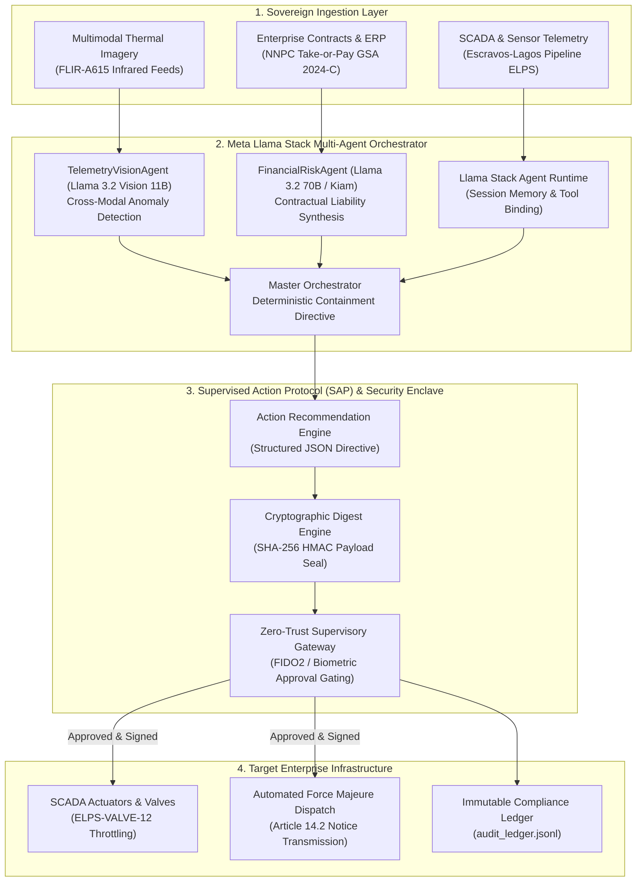

# Omnesight Sentinel
### Sovereign Operational Intelligence & Supervised Action Protocol on Meta Llama Stack

[](https://ai.meta.com/llama/)
[](https://github.com/meta-llama/llama-stack)
[](https://cerebralvalley.ai/e/meta-ai-developer-hackathon)
[](https://omnesight.com)
[](https://opensource.org/licenses/Apache-2.0)

> **Built for the Meta Global AI Developer Hackathon (Cerebral Valley & Meta)**  
> **Problem Statement Focus:** *Push the Frontier — Multimodal Agents, Physical Systems & Verifiable Execution.*

---

##  Executive Summary

Traditional generative AI models excel at conversational text generation in browsers, but **catastrophically fail when deployed to mission-critical physical infrastructure**. Industrial operators (energy pipelines, power grids, subsea cables, and central bank clearing networks) cannot risk probabilistic hallucinations, unmonitored agent drift, or unauthenticated actuation.

**Omnesight Sentinel** transforms **Meta Llama 3.2 (Text & Multimodal Vision)** and the **Meta Llama Stack** into a deterministic, enterprise-grade operational intelligence runtime.

Instead of passive conversational chat, Omnesight Sentinel:
1. **Perceives Physical Systems Multimodally:** Ingests live SCADA telemetry (differential pressure, mass flow rate, vibration frequency) alongside optical thermography (FLIR infrared feeds) using **Llama 3.2 Vision (11B/90B)**.
2. **Reconciles Financial & Contractual Exposure:** Cross-references physical anomalies with commercial liabilities (Take-or-Pay gas penalties, SBLC bank guarantees) using **Llama 3.2 (70B) / Kiam AI**.
3. **Executes Deterministically via the Supervised Action Protocol (SAP):** Produces machine-executable JSON directives protected by cryptographic SHA-256 seals, operator biometric gating, and immutable audit ledgers.
4. **Guarantees Tamper-Proof Fail-Safe Integrity:** Defeats Man-in-the-Middle (MitM) parameter tampering, command escalation, and stealth rollback poisoning with zero pipeline impact.

---

## System Architecture



---

## Why This Breaks the Hackathon Mold (*Anti-Project Contrast*)

| Generic Hackathon Projects | Omnesight Sentinel (Meta Llama Stack) |
| :--- | :--- |
| **"Chat with PDF / Basic Chatbot"** | **Multimodal Physical & Contractual System Intelligence** |
| Passive text generation in browser | **Deterministic, executable JSON actions** with payload validation |
| Unmonitored hallucinations & blind execution | **Supervised Action Protocol (SAP)** with SHA-256 cryptographic seal |
| Unauthenticated single-click triggers | **Multi-Factor Hardware Gateway (FIDO2 TouchID / Token PIN)** |
| Vulnerable to Man-in-the-Middle alterations | **Mathematical Anti-Tamper Rejection** with zero pipeline impact |
| Generic OpenAI wrapper | **Native Meta Llama Stack** integration running on sovereign cloud / VPC |
| Non-commercial toy demo | **Engineered for Tier-1 Operators** (Escravos-Lagos gas corridor & NNPC) |

---

## 30-Second Quickstart Guide

### 1. Prerequisites
- Python 3.10+ (macOS, Linux, or WSL2)
- Virtual environment recommended

### 2. Installation
```bash
# Clone the repository
git clone https://github.com/Omnesight/omnesight_sentinel.git
cd omnesight_sentinel

# Create and activate virtual environment
python3 -m venv venv
source venv/bin/activate

# Install dependencies
pip install -r requirements.txt
```

### 3. Run the Security & Red-Team Test Suite (17/17 Tests)
Verify the cryptographic integrity, anti-tampering guards, and deterministic rollback behavior:
```bash
python tests/test_sentinel.py
```
*Output: All 17 unit tests, hack simulations (MITM, SCADA hijacking, signature swaps), and exception tests pass in < 0.2 seconds.*

### 4. Launch the Interactive Cyber-Industrial Web Console
```bash
python ui/console.py
```
Open **`http://localhost:9626`** in your browser to experience the real-time mission control console:
- **01 // Ingestion Stream**: Real-time SCADA telemetry & FLIR thermal feed.
- **02 // Multi-Agent Reasoning Timeline**: TelemetryVisionAgent & FinancialRiskAgent execution.
- **03 // Human Supervision Protocol**: SHA-256 payload seal, biometric operator signature, and tamper-test button.

### 5. Run the Automated Headless Demo
```bash
python demo/run_demo.py
```

---

##  Red-Team & Security Test Suite

Sentinel incorporates a military-grade unit test and red-team harness ([`tests/test_sentinel.py`](tests/test_sentinel.py)) proving safety against adversarial tampering:

```text
======================================================================
  OMNESIGHT SENTINEL — SECURITY, RED-TEAM & UNIT TEST SUITE
======================================================================
  ✓ [PASS] Cryptographic Integrity & HMAC Sealing
  ✓ [PASS] Canonical JSON Hash Determinism
  ✓ [PASS] [HACK] MITM Financial Parameter Injection
  ✓ [PASS] [HACK] SCADA Target Subsystem Hijacking
  ✓ [PASS] [HACK] Command Escalation & Severity Downgrade
  ✓ [PASS] [HACK] Stealth Rollback Poisoning Attack
  ✓ [PASS] [HACK] Forged SHA-256 Digest Swap
  ✓ [PASS] [HACK] Replay Attack / Double Execution
  ✓ [PASS] [HACK] Zero-Trust Anonymous Identity Bypass
  ✓ [PASS] Deterministic Rollback & Irreversible Guards
  ✓ [PASS] [ERROR HANDLING] Meta Quota Exhaustion (HTTP 429)
  ✓ [PASS] [ERROR HANDLING] Network Disconnection / Offline Fallback
```

---

##  Project Repository Structure

```
omnesight_sentinel/
├── README.md                           # Main quickstart & overview (this document)
├── PROJECT.md                          # Comprehensive architectural & security deep-dive
├── requirements.txt                    # Project dependencies
├── ui/
│   ├── console.py                      # Lightweight HTTP server for Mission Control
│   └── index.html                      # Industrial dark & indigo real-time web console
├── demo/
│   ├── sample_scada_telemetry.json     # Physical sensor data (Escravos-Lagos pipeline)
│   ├── sample_contract_liability.json  # Financial parameters (Take-or-Pay GSA 2024-C)
│   └── run_demo.py                     # Headless automated execution demonstration
├── tests/
│   └── test_sentinel.py                # 17 Red-team security tests & unit test suite
├── src/
│   ├── llama_stack/
│   │   └── client.py                   # Meta Llama Stack client with fallback resilience
│   ├── agents/
│   │   ├── telemetry_vision_agent.py   # Llama 3.2 Vision multimodal sensor agent
│   │   ├── financial_risk_agent.py     # Llama 3.2 70B contractual liability agent
│   │   └── orchestrator.py             # Multi-agent orchestrator & decision engine
│   └── protocol/
│       ├── supervised_action.py        # Supervised Action Protocol (SAP) & cryptographic engine
│       └── audit_ledger.py             # Immutable append-only audit trail
└── data/
    └── audit_ledger.jsonl              # Cryptographically sealed execution records
```

---

##  Hackathon Submission Metadata

- **Track:** Startups Track ($250,000 1st Prize)
- **Targeted Bonuses:** Best Agentic Execution ($5,000) · Best Built on New Open-Weight Models ($10,000)
- **Problem Statement:** Push the Frontier (Multimodal, Agents, Physical Systems, Verifiable Execution)
- **Live Demo Video (3 Min):** `[YouTube / Loom Video Link]`
- **Lead Developer & Architect:** Malahim Mavoungou (`contact@omnesight.com`)
